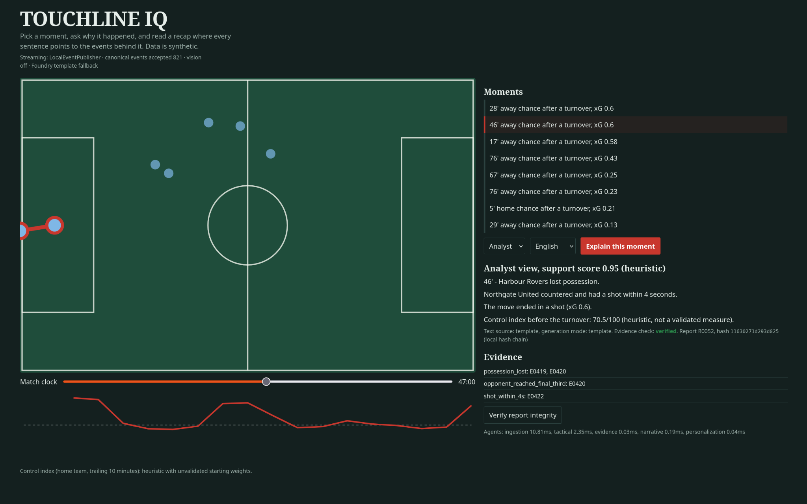

# TOUCHLINE IQ




Touchline IQ is an explainable football intelligence platform designed for the Microsoft + Premier League *Inside the Game* hackathon. The system models a match as a traceable, player-aware event graph, where every player is treated as a distinct identity, each possession phase is connected to tactical context, and every narrative is anchored to matching evidence before it is surfaced.

The platform is built to feel like a real analyst workstation: it identifies critical moments, explains tactical patterns, exposes supporting evidence, and verifies the output before it is shared with stakeholders.

## Why enterprises care
Modern football analysis is not just about outcomes; it is about decision-quality. Teams need to understand not only what happened, but why it happened, which players and units created the conditions, and whether a narrative can be defended with evidence.

Touchline IQ turns complex match-state data into a structured, auditable story for fans, analysts, coaches, and media teams. It creates a shared operational layer between tactical reasoning and narrative communication.

The platform answers questions such as:
- Which player or unit caused the dangerous transition?
- What evidence supports the claim?
- Which phase of play created the opportunity?
- How does the explanation differ for a supporter, pundit, or tactical analyst?

## Product capability
- Builds a synthetic match with player identities, role assignments, and team context
- Detects dangerous transitions and flags the moment with event-level evidence
- Measures pressure and control with a Touchline Control Index
- Explains a selected match moment using a multi-stage analysis pipeline
- Produces audience-aware, multilingual recaps from shared facts
- Preserves provenance using a local SHA-256 ledger for tamper checking
- Joins video timestamps to match timeline data via explicit offsets
- Exposes the workflow through a FastAPI-backed analyst dashboard

## Product framing
Touchline IQ is intentionally positioned as a realistic analytical product rather than a toy demo. Its synthetic dataset still includes separately identifiable players, role-based behavior, event chains, and tactical context, allowing the system to narrate the game in player-by-player detail rather than as a generic team summary.

The product is designed for:
- tactical analysts reviewing match patterns
- media teams producing explainable recaps
- product teams demonstrating grounded AI in football operations
- executive stakeholders evaluating explainability, trust, and operational maturity

## Microsoft architecture
The solution is structured to align with the Microsoft stack described in the roadmap:

- App layer: FastAPI + interactive dashboard
- AI reasoning: Python analysis pipeline with fact validation and grounded narrative generation
- LLM integration: Azure AI Foundry / OpenAI-compatible endpoint via `llm_render`
- Agent orchestration: Microsoft Agent Framework path for future execution staging
- Event ingestion: Fabric Eventstream and Eventhouse patterns for streaming match data
- Data persistence: Cosmos DB for reports, sessions, and match metadata
- Search: Azure AI Search for evidence, context, and clip retrieval
- Observability: Azure Monitor + OpenTelemetry for operational telemetry
- Trust layer: local SHA-256 ledger with optional Hedera anchoring for external attestation

## Status
| Capability | State |
|---|---|
| Seeded synthetic match generator + consistency validator | Implemented, unit-tested |
| Dangerous-transition detection with event-ID evidence | Implemented, unit-tested |
| Touchline Control Index (unvalidated weights) | Implemented, range-tested |
| 4-agent pipeline (ingestion, tactical, evidence, narrative, personalization) in plain Python | Implemented, unit-tested |
| Multilingual recap (en/sw/fr/es) from shared facts; LLM output rejected if ungrounded | Implemented, unit-tested. Swahili/French/Spanish strings need native-speaker review |
| Local SHA-256 hash-chain ledger + tamper check | Implemented, unit-tested |
| Video-time to match-time join (explicit offset) | Implemented, unit-tested |
| FastAPI API + dashboard | Running locally in the dev environment |
| Foundry narrative (`llm_render`) | Implemented with template fallback; real deployment remains optional |
| YOLO detection (`detect_video`) | Written as an optional extension; not required for the local demo |
| Microsoft Agent Framework port | Planned and scoped for staged production rollout |
| Fabric Eventstream / Eventhouse, Cosmos DB, AI Search, Azure Monitor | Planned architecture targets |
| Hedera anchoring | Optional stub; not live in production |

## Run
```bash
python -m venv .venv
source .venv/bin/activate
pip install -r requirements.txt
python -m unittest discover -s tests -v
uvicorn touchline.api:app --host 0.0.0.0 --port 8000
```

Open the app at http://127.0.0.1:8000

Foundry (optional): set `FOUNDRY_ENDPOINT`, `FOUNDRY_API_KEY`, and `FOUNDRY_MODEL` for an OpenAI-compatible endpoint. Without those values, the recap remains labelled `template` and stays grounded in locally validated templates rather than a live deployment.

## Demo flow
1. Load the synthetic match and inspect the player timeline.
2. Select a key match moment such as a dangerous transition.
3. Run Explain to generate the tactical narrative and evidence set.
4. Switch audience and language to see different recap styles from the same grounded facts.
5. Use Verify to confirm that the report remains consistent with the ledger and evidence chain.

## Next steps
1. Continue validating the local app, dashboard, and route contract in a live development environment.
2. Wire a real Foundry deployment while retaining `validate_llm` as the governing quality gate.
3. Port the analysis stages to Microsoft Agent Framework executors with the same typed outputs.
4. Deploy to Azure Container Apps, persist match and report data in Cosmos DB, and add telemetry via Azure Monitor / OpenTelemetry.
5. Extend toward Fabric Eventstream ingestion, YOLO clip processing, and Hedera `HederaLedger.anchor`.
6. Record a concise product demo around a single key moment: select 67', explain, switch audience and language, verify.

## Known limits
- The Touchline Control Index is intentionally lightweight and saturates in the synthetic generator.
- Video links reflect event-time co-occurrence rather than definitive proof of a pass or shot.
- Real Microsoft service integration is planned architecture work, not a live production dependency for the local demo.
- Multilingual copy should still be reviewed by native speakers before any external-facing deployment.

The project remains intentionally honest: the current local build is working and demonstrable, while the broader Azure, Fabric, and agentic deployment layer represents the next production stage rather than a present live dependency.
# touchline-iq
